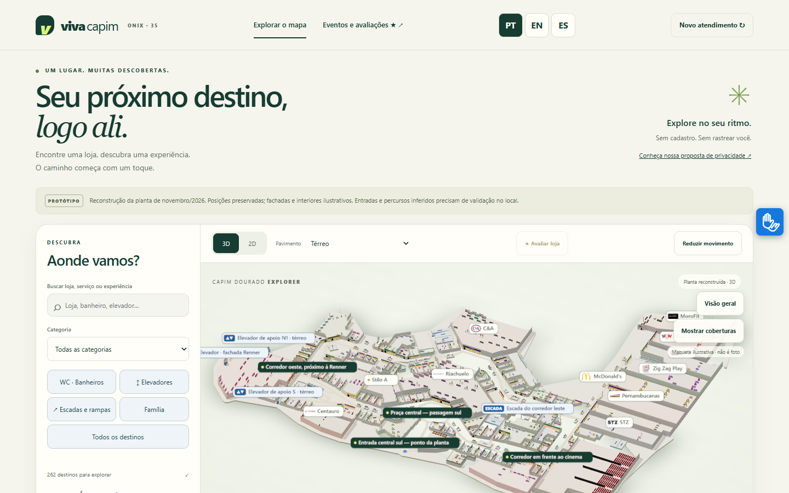
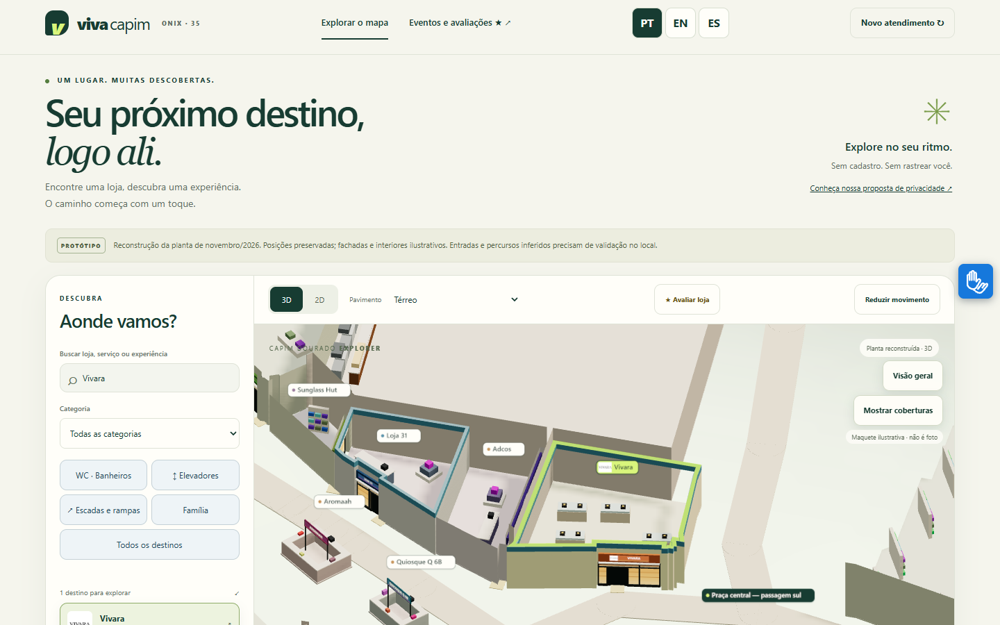
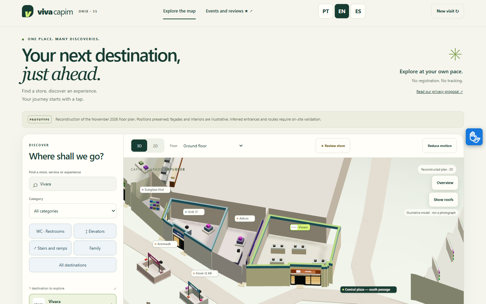
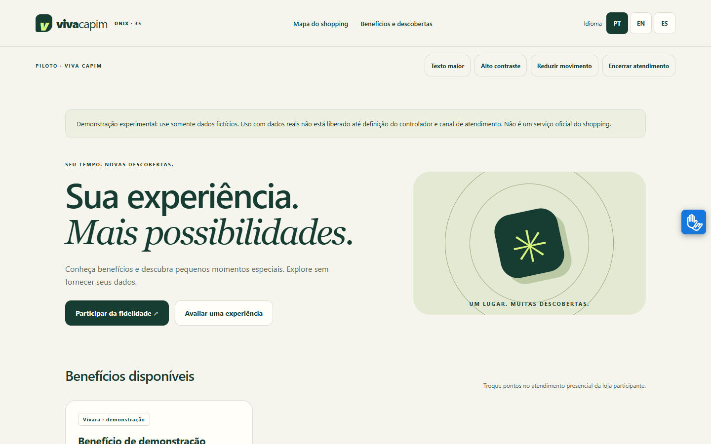
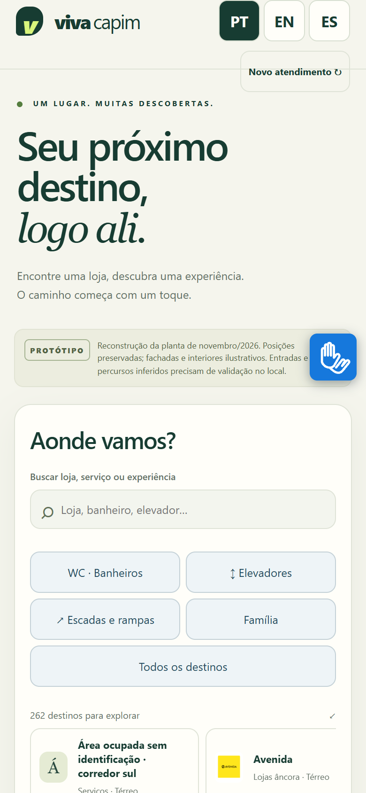
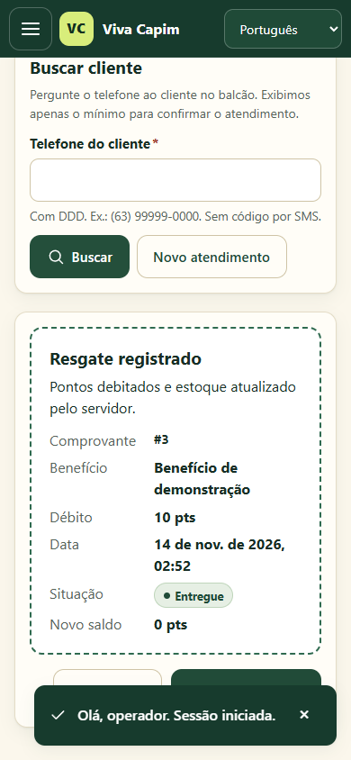
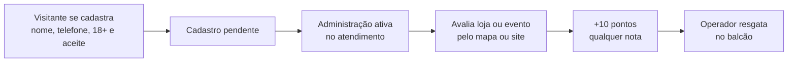

<div align="center">

# viva capim

**Seu próximo destino, logo ali.**

Mapa 3D, eventos, avaliações e fidelidade para o Capim Dourado Shopping<br>
HackaRun 2026 · Equipe **Onix 35**

[](https://onix35-viva-capim.vercel.app/explorar.html)
[](https://onix35-viva-capim.vercel.app/participar/)
[](https://onix35-viva-capim.vercel.app/dashboard/)




</div>

> **Protótipo de demonstração.** Use somente dados fictícios. A planta foi reconstruída com posições preservadas; fachadas e interiores são ilustrativos e percursos inferidos precisam de validação no local. Não é um serviço oficial do shopping.

## ✨ O que dá para fazer

| | |
|---|---|
| 🗺️ **Explorar sem cadastro** | Buscar lojas, banheiros, elevadores e serviços em 3D ou 2D, com 262 destinos e zoom na loja escolhida. |
| 🧭 **Rotas entre pisos** | Percurso passo a passo, com opção acessível que só usa conexões comprovadas na planta. |
| 🌎 **Três idiomas** | Botões PT / EN / ES traduzem menus, lojas, serviços e instruções sem perder a rota em andamento. |
| 🤟 **Libras** | VLibras opcional, carregado só depois do aceite e nunca em páginas com dados pessoais. |
| ⭐ **Avaliar e ganhar pontos** | Fidelidade opcional: 10 pontos por avaliação elegível, **qualquer que seja a nota**. |
| 🎁 **Resgate no balcão** | Operador autenticado localiza o cliente e confirma a entrega, sem débito duplicado. |
| 🏪 **Painel por perfil** | Administração, lojista (somente a própria loja e médias agregadas) e operador de balcão. |

<table>
<tr>
<td width="50%"><br><sub><b>Selecionar uma loja</b>: zoom, destaque e atalho para avaliar.</sub></td>
<td width="50%"><br><sub><b>Trocar o idioma</b> mantém origem, destino e percurso.</sub></td>
</tr>
<tr>
<td width="50%"><br><sub><b>Área pública</b>: benefícios, eventos e fidelidade opcional.</sub></td>
<td width="50%" align="center"> <br><sub><b>No celular</b>: mapa e resgate no balcão (dados fictícios).</sub></td>
</tr>
</table>

## 🔄 Como funciona a fidelidade



- Uma concessão por loja a cada 30 dias, uma por evento e no máximo 30 pontos por dia.
- Sem login de membro, sem consulta pública de saldo e sem resgate pela internet.
- O telefone é **autodeclarado** (não há SMS/OTP) e não comprova identidade: risco aceito e documentado.
- Lojistas veem apenas médias com pelo menos cinco avaliações, sem nome ou telefone.

## ✅ Qualidade

| Verificação | Resultado |
|---|---|
| Testes Django com PostgreSQL | **56 aprovados**, sem skips |
| Regressão do mapa e laboratório | **69 aprovados** |
| Ciclo de fidelidade no site publicado | **23 verificações de API + 15 de interface** |
| Idiomas, Libras, inatividade, mobile e painel | Relatórios em [`docs/`](docs/EVIDENCIAS_PILOTO.md) |

Resultados por versão e limites estão em [Evidências do piloto](docs/EVIDENCIAS_PILOTO.md).

## 🗂️ Estrutura

| Pasta | O que tem |
|---|---|
| [`pilot/`](pilot/) | Backend Django: autenticação, permissões, painel, fidelidade e API ([contrato](pilot/API.md)) |
| [`laboratorio/`](laboratorio/README_LAB.txt) | Mapa 3D/2D, catálogo, logomarcas, rotas e a autoridade da planta |
| [`docs/`](docs/) | Decisões, requisitos, privacidade, operação e evidências |
| [`missao-1/`](missao-1/) | Planejamento original do HackaRun ([PDF da primeira entrega](missao-1/ONIX_35_VIVA_CAPIM_MISSAO_1.pdf)) |

## 🚀 Rodar localmente

```powershell
python -m pip install -r pilot/requirements.txt
cd pilot
python manage.py migrate
python manage.py test
python manage.py runserver 127.0.0.1:8879
```

Mapa independente do laboratório: `laboratorio/ABRIR_LABORATORIO.cmd`. Operação, deploy e verificações: [Runbook](docs/RUNBOOK.md) · [Vercel + Supabase](docs/DEPLOY_SUPABASE_VERCEL.md).

## 📚 Documentação

[Escopo do piloto](docs/PLANO_PILOTO.md) · [Arquitetura](docs/ARQUITETURA.md) · [Privacidade](docs/PRIVACIDADE.md) · [Equipe e backlog](docs/EQUIPE_E_BACKLOG.md) · [Pesquisa e fontes](docs/PESQUISA.md) · [Como contribuir](CONTRIBUTING.md) · [Segurança](SECURITY.md)

## 👥 Equipe Onix 35

| Integrante | Papel |
|---|---|
| **Helder Filgueira** | Frontend e liderança |
| **Gabriel Schimit** | Backend |
| **Luis** | QA |
| **Robson** | Integração e operação |

Desenvolvido com assistência de agentes de IA (Claude Opus 5.5), declarada na documentação; os agentes não substituem os responsáveis humanos nem a revisão da equipe.

## ⚠️ Limites

A rota acessível não cria acesso ao elevador sem evidência na planta. "Você está aqui" é a origem escolhida, não rastreamento. Traduções EN/ES ainda sem revisão de falantes nativos. Não há promessa de conformidade LGPD, acessibilidade certificada, SMS, pontos retroativos ou disponibilidade contínua em plano gratuito. Uso com dados reais depende de controlador e canal de direitos definidos, backup testado e revisão humana.
