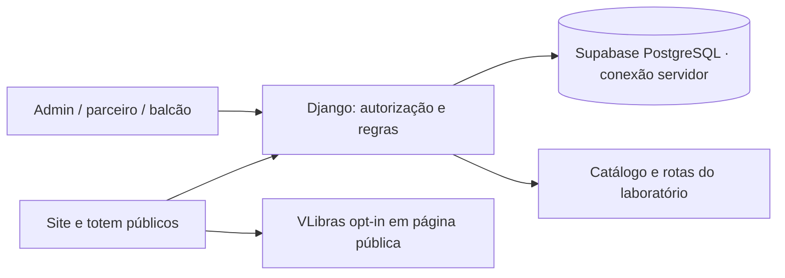

# ADR-002 · Monólito Django para o piloto

**Decisão:** adotada para implementação em 14/11/2026. **Estado operacional:** sujeito às verificações do runbook.

## Contexto e decisão

O laboratório usa Python padrão, SQLite e JavaScript. Sua credencial administrativa única não atende isolamento de parceiros, aprovação de conteúdo e resgates. O novo módulo `pilot/` usa Django 5.2, preservando Python, templates/HTML e a autoridade do mapa em `laboratorio/`. Não converter toda a experiência em outra stack nem reescrever a planta.

## Fronteiras

Django é responsável por autenticação de operadores, escopo organizacional, publicação de conteúdo, cadastro pendente, pontuação, benefícios e resgates. Toda autorização e validação de saldo/estoque ocorre no servidor. Esconder botão não constitui autorização.

O catálogo/geometria/rotas de `laboratorio/` continua fonte de referência. A integração deve consumir ou copiar de forma rastreável uma versão, sem editar uma segunda geometria independente. A ausência de caminho comprovado continua uma ausência de rota, inclusive no novo portal.

Carteira global não significa acesso global ao cadastro: parceiro recebe somente dados necessários ao próprio fluxo e resultados agregados. Uma avaliação premiada gera no máximo um lançamento correspondente. Operações de crédito/resgate exigem proteção contra repetição e concorrência. Correções precisam de trilha de auditoria, não edição silenciosa do histórico.

## Ambiente e compatibilidade

Desenvolvimento local pode usar banco local conforme configuração do módulo; o piloto na internet usa PostgreSQL do Supabase, acessado somente pelo backend. Não extrapolar teste SQLite para garantir concorrência PostgreSQL. Sessões, CSRF, hashes de senha, migrações e permissões usam recursos do Django; escopo por organização deve ser aplicado explicitamente em cada consulta e mutação.

O deploy escolhido usa suporte nativo Django na Vercel e Supabase PostgreSQL. Docker fica disponível como alternativa portável, não como substituição automática. O projeto Supabase já foi criado; conexão, migrações e seed foram concluídos, com 22 tabelas/RLS verificadas e leitura direta negada a anon/authenticated. Veja [evidências](EVIDENCIAS_PILOTO.md). O domínio Vercel canônico está publicado e passou pelas jornadas verificadas de API, mapa, páginas públicas e dashboard. Isso não substitui revisão humana do PR nem liberação para dados reais. Segredos ficam no ambiente, sem defaults de produção. O servidor `runserver` é somente local. `laboratorio/` e a Missão 1 permanecem executáveis e preservados separadamente.

## Consequências

A pilha aproveita o backend Python e reduz dependências de frontend. Acrescenta instalação de Django, migrações e operação de banco. Não haverá migração automática de sessões anônimas antigas para membros nem crédito retroativo. Saldos, cadastro e direitos exigem novos testes; os testes anteriores do mapa continuam regressão obrigatória.

## ADR-003 · Vercel + Supabase escolhidos

A autenticação de operadores continua no Django. Não é introduzido Supabase Auth nem SDK/chaves Supabase no navegador. O banco usa conexão transacional do pooler para execução serverless; preparar o driver para não depender de prepared statements nem cursores mantidos entre transações. Credenciais e conexão pertencem somente ao servidor.

Ativar RLS nas tabelas expostas e negar acesso direto dos papéis públicos/usuários da Data API às tabelas do piloto, incluindo autenticação e sessões Django. RLS não substitui as verificações de papel e organização dentro do backend. A configuração precisa ser verificada no banco provisionado antes de afirmar bloqueio efetivo.

Retenção diária usa Vercel Cron e rota autenticada por segredo de cron. Ter `vercel.json` não prova execução agendada: verificar autenticação, rejeição de chamadas sem segredo e primeiro disparo real. Migrações são operação controlada antes da publicação, não por requisição web.

A documentação oficial informa suporte Django pela Vercel CLI a partir de 50.38.0. Detalhes, fontes e estado do provisionamento estão em [deploy](DEPLOY_SUPABASE_VERCEL.md).
